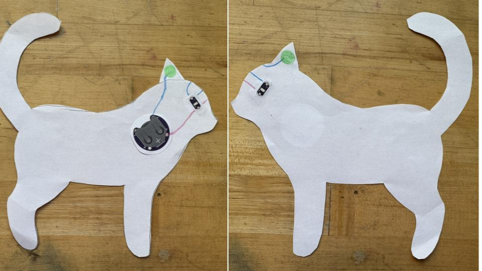
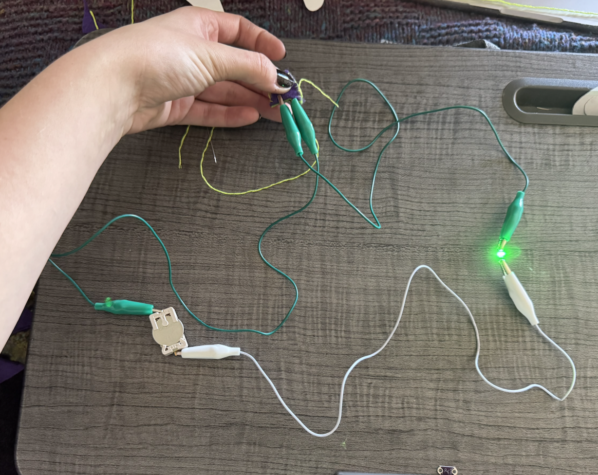
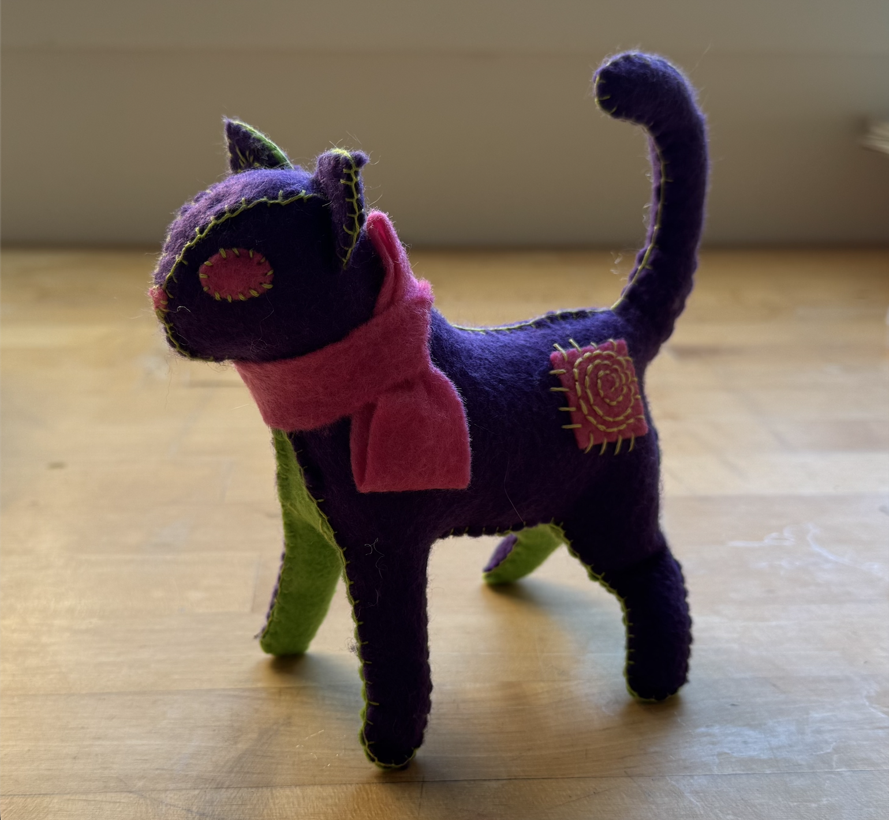
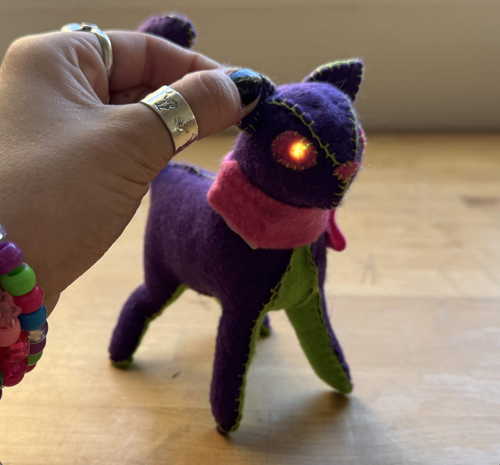

Meet Frankencat! She is a simple circuit controlled by a conductive fabric homemade switch located in her ear. She was inspired by Sally from The Nightmare Before Christmas in her patchwork style stitching.

materials list:
assorted felt and embroidery thread, conductive thread, conductive fabric, battery, battery holder, two green LEDs. 

One tip for my past self would be to to half stuff the plush before putting the circuit together to better provide a stable base. A second tip would be 
be to move the location of the battery back a bit so it is more easily hidable.

Paper prototype:

Alligator prototype:

Frankencat while the button is unpressed:

Frankencat while the button is pressed:

Here is a link to the felt cat pattern I used: https://liagriffith.com/felt-cat/
